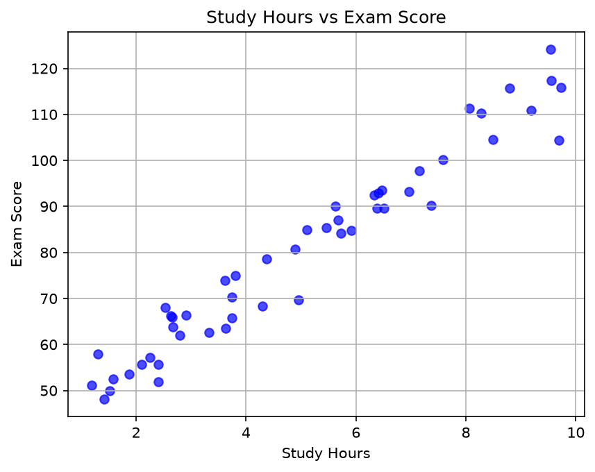

# Blueeeee517

## Introduction
Hello, I am Blueeeee517. I am learning data science and building my portfolio through practical projects. This portfolio showcases my data analysis work.

## Technical Skills
- Python
- pandas
- matplotlib
- numpy
- Jupyter Notebook
- GitHub

## Project Showcase

### Student Study Time and Scores Analysis
**Research question:** Is there a relationship between the number of hours a student studies and their exam score?

**Brief explanation:** The scatter plot shows a clear positive correlation: as study time increases, exam scores generally increase. Students who studied for more than 6 hours scored significantly higher on average.

**Project repository:** [data-science-project](https://github.com/Blueeeee517/data-science-project)

**Project status:** Completed
